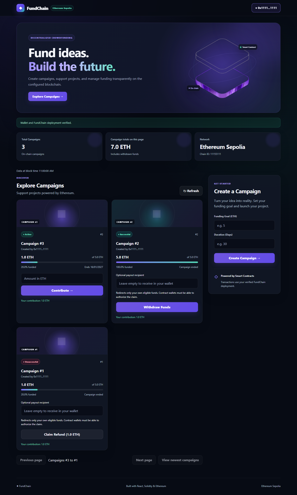
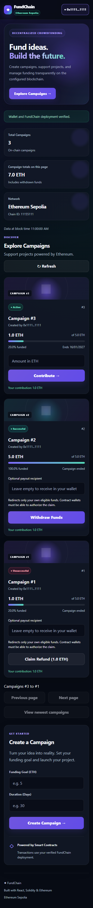

# FundChain

A Solidity + React crowdfunding DApp with campaign-isolated ETH accounting,
recoverable payouts, verified wallet sessions, and a mobile-first dark interface.
This is a **Sepolia testnet portfolio project**, not a mainnet-ready financial product.

[CI](https://github.com/yassinweb3/fundchain/actions/workflows/test.yml) |
[Sepolia contract](https://sepolia.etherscan.io/address/0xC0ea3c8c97334955f02D357604346b32F8A4151E) |
[Deployment guide](DEPLOYMENT_SEPOLIA.md) | [Frontend guide](frontend/README.md)

## Screenshots

Desktop and mobile captures use deterministic, simulated wallet/campaign data;
they do not represent live contributions or send transactions.



<details>
<summary>Mobile dashboard (375px)</summary>



</details>

## Features

- Create campaigns with an ETH goal and deadline; contribute to active campaigns.
- Owners withdraw successful campaigns; contributors refund unsuccessful ones.
- `withdrawTo` and `refundTo` redirect only the caller's eligible payout, allowing
  recovery when the original recipient rejects ETH. Legacy methods remain supported.
- Chain ID and exact runtime-bytecode checks guard wallet connection and signing.
- Account/network changes invalidate sessions; stale reads cannot restore old data.
- Transaction tracking remains mounted across wallet changes and lazy loading.
  Uncertain submissions block new actions until status is reviewed.
- Bounded pages of 12 campaigns; reads share a block snapshot and stale responses
  are discarded. Displayed page totals include withdrawn amounts and exclude refunded amounts;
  they are neither the contract balance nor lifetime contribution totals.
- Fluid typography, responsive grids, keyboard navigation, accessible form errors,
  44px touch targets, and reduced-motion support.

## Architecture

```text
src/Crowdfunding.sol                 Campaign accounting, withdrawals and refunds
script/DeploySepolia.s.sol           Sepolia-only deployment script (simulation by default)
test/                               Unit, adversarial, fuzz, payout and invariant tests
tools/sepolia_preflight.py           Offline/RPC identity checks and unsigned simulation
frontend/src/App.tsx                 Persistent frame and lazy workspace loading
frontend/src/WalletWorkspace.tsx     Mounted wallet/data/transaction controllers
frontend/src/useWalletSession.ts     Session identity and invalidation
frontend/src/useCampaigns.ts         Bounded pagination and coordinated reads
frontend/src/useTransaction.ts       Submission and receipt state machine
frontend/src/web3.ts                 ethers provider and transaction boundary
frontend/src/components/             Campaign, form, statistics and status views
frontend/e2e/                       Mocked-wallet Chromium layout/screenshot tests
.github/workflows/test.yml          Solidity and frontend CI gates
```

The frontend talks directly to the injected wallet provider. There is no backend,
indexer, custodial signing service, or database. The ABI and expected runtime hash
are generated from the pinned Foundry artifact and checked for drift.

## Reproducible setup

Use **Foundry 1.8.1**, **Solc 0.8.36**, **Node 24.15.0**, and **npm 11.12.1**.
Solidity development on Windows uses WSL 2 Ubuntu. Preserve the pinned Osaka EVM
target, disabled optimizer, and disabled via-IR to preserve bytecode identity.
Install these tools separately using their official instructions; do not run an
unreviewed bootstrap script. The commands below install repository dependencies
and the test browser when you choose to run them.

```bash
git clone --recurse-submodules https://github.com/yassinweb3/fundchain.git
cd fundchain
forge build
```

In Windows, run `forge` inside WSL from the same repository (for example beneath
`/mnt/c/Users/<you>/...`). Then use PowerShell for the frontend:

```powershell
cd frontend
npm.cmd ci
Copy-Item .env.example .env.local
npm.cmd run dev
```

On Linux, use `npm` instead of `npm.cmd`. Do not share `node_modules` between
Windows and Linux. `npm ci` installs the reviewed lockfile without updating it.

### Sepolia frontend configuration

Put only these **public** values in ignored `frontend/.env.local`, then restart Vite:

```dotenv
VITE_CHAIN_ID=11155111
VITE_NETWORK_NAME=Ethereum Sepolia
VITE_CONTRACT_ADDRESS=0xC0ea3c8c97334955f02D357604346b32F8A4151E
```

The example file defaults to local Anvil (31337); use the values above for the
existing Sepolia deployment. Install MetaMask, select Sepolia, and use test funds
only. Missing wallets, rejected requests, wrong networks and mismatched contracts
produce visible errors. Network changes require reconnecting.

For local development, run `anvil` in WSL and follow the local contract workflow
in [the frontend guide](frontend/README.md). A default local address is only a
configuration example; a matching deployed runtime must exist before connecting.
No deployment is performed by setup, frontend startup, or tests.

Never place API keys, private keys, seed phrases, passwords or keystore JSON in
Vite variables: they are compiled into public browser assets. Keep encrypted
signing material outside the repository. `.env.local`, broadcast records, build
outputs, dependencies, keystore/key files and browser reports are ignored.

## Sepolia deployment record

| Field | Value |
| --- | --- |
| Network | Ethereum Sepolia, chain ID `11155111` |
| Contract | `0xC0ea3c8c97334955f02D357604346b32F8A4151E` |
| Deployment transaction | [`0x781a270c27d5127ef1ab32613dca6c07fb939c1526276fbbf8285f57408b96a0`](https://sepolia.etherscan.io/tx/0x781a270c27d5127ef1ab32613dca6c07fb939c1526276fbbf8285f57408b96a0) |
| Recorded block | `12169771` |
| Expected runtime keccak256 | `0xcf45e836283160aefdf4dccb3a9ab6c076b4366a18cdb74022ba2e047c0f2fe3` |
| Etherscan source verification | **Pending**; a valid API v2 key is still required |

Receipt and runtime identity were verified during the approved deployment. The
current offline build reproduces the hash above; this review does not redeploy
or certify explorer source verification. Source verification and on-chain runtime
identity are separate checks. See the deployment guide for exact compiler inputs,
read-only identity checks, encrypted-keystore handling, and recovery procedures.

## Validation

From the repository root in WSL/Linux:

```bash
forge fmt --check
forge build --sizes
FOUNDRY_PROFILE=security forge test -vv
python3 -B -m unittest discover -s tools/tests -v
python3 -B tools/sepolia_preflight.py --mode offline
```

From `frontend` in PowerShell:

```powershell
npm.cmd ls
npm.cmd audit
npm.cmd audit --omit=dev
npm.cmd run contract:check
npm.cmd test
npm.cmd run lint
npm.cmd run build
npm.cmd run check:bundle
npx.cmd playwright install chromium
npm.cmd run test:responsive
```

On a fresh Linux CI worker, `npx playwright install --with-deps chromium` also
installs the browser's OS libraries. Browser tests mock all wallet RPC calls,
reject signing/submission methods, and block external HTTP requests.

Verified locally on **November 20, 2026**:

| Check | Result |
| --- | --- |
| Solidity | 82 tests passed; 1,000 iterations per fuzz test |
| Invariants | Four properties; 256 runs at depth 128; zero handler reverts |
| Contract size | 4,398-byte runtime; 4,426-byte creation bytecode |
| Offline preflight | 16 tests passed; runtime identity matched |
| Frontend | 109 tests passed; lint, TypeScript/build and ABI check passed |
| Responsive Chromium | 13 tests, including seven viewport widths and 200% text |
| JS bundle budgets | Initial gzip 69,623 B; total gzip 172,120 B, both within limits |

The responsive suite covers 320, 375, 430, 768, 1024, 1440 and 1920px, long amounts,
payout address previews, connected/disconnected wallets, and loading/error/empty
states. It checks overflow, content bounds, touch targets, hero scaling and grid
columns. Screenshots are review artifacts; geometry assertions detect layout
regressions. CI uploads browser reports and runs the Solidity security profile,
offline deployment checks, dependency tree/audit policy, ABI, frontend tests,
lint, build, bundle budgets, and responsive checks without signing credentials.

## Security and remaining limitations

- **Nine moderate npm package findings** remain from one minimatch glob-pattern
  denial-of-service advisory in development lint tooling. No high/critical findings
  were reported. See [the expiring tooling exception](TOOLING_RISK_EXCEPTION.md)
  for dependency paths, controls, expiry and remediation requirements. The current
  audit reports upstream fixes available; review a separate compatible update.
- Etherscan source verification is pending. Do not describe this deployment as
  explorer source verified until verification succeeds.
- This repository has security regression tests, not an independent professional
  audit or proof of mainnet safety. Forge lint still reports reviewed low-level
  ETH calls, timestamp usage, and test-helper/style warnings.
- Chromium viewport emulation is not physical Safari/iOS/Android or real MetaMask
  validation. Complete the real-wallet matrix in the deployment guide separately;
  automated browser tests do not send transactions.
- Pending transaction state is held in memory. After a full reload, check wallet
  history/explorer before retrying an uncertain action.
- Reads depend on wallet RPC availability; there is no indexer, search, or public
  read-only campaign browsing before wallet connection.
- Historical local simulation and live RPC gas estimates differed. Re-estimate
  against two providers and obtain explicit fee/broadcast approval for any future
  transaction; never reuse a historical gas quote blindly.

The review prepares the improvement branch for a testnet portfolio release.
Mainnet deployment, production hosting, and merging into `main` are separate work.
